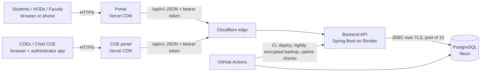

# Architecture

## Request path

1. Both frontends are static files on Vercel's CDN with strict security headers (Content-Security-Policy, HSTS,
   X-Frame-Options, ...). They only talk to the API.
2. Every API call goes through, in order: client address (`CF-Connecting-IP`), request id, `/api/v1` mapping,
   per-address rate limit, token check (`TokenAuthFilter`: session valid, not idle, password and two-step set-up
   done), the Super Admin's locks (`GovernanceFilter`), then role rules per route group (`SecurityConfig`):
   `/api/student/**` STUDENT, `/api/faculty/**` FACULTY, `/api/hod/**` HOD, `/api/admin/**` COE, `/api/super-admin/**`
   Chief COE. A student's register number always comes from the session, never from the request.
3. Grades, GPA, pass/fail and all marks totals are computed only in the backend (`grading/GradeCalculator`,
   `marks/MarkService`); the frontends display what the API returns.
4. Results move DRAFT → VALIDATED (forwarded by faculty) → PUBLISHED (by the COE, all subjects of a department at
   once) → WITHDRAWN (by the COE, with a reason). Students and HODs see only PUBLISHED.
5. Every COE action is written to `audit_logs` (who, when, what, old/new value, request id). The database refuses
   updates and deletes on that table (trigger); only the retention job can purge entries older than 7 years.
6. Published results are cached in memory for 10 minutes and the cache is cleared on every publish, withdrawal or
   student change (`common/ResultsCache`); the database stays the source of truth.

## Data

PostgreSQL schema is versioned by Flyway (`backend/src/main/resources/db/migration`, V1 to V16). Main tables:
`students`, `subjects`, `marks` (answer-script marks, versioned for edit conflicts), `result_batches` +
`result_records` (published snapshots), `internal_marks`, `users`, `auth_tokens` (hashed), `audit_logs`,
`notifications`, `faculty_master`, `answer_scripts`, `system_config`.

## Why it is built this way

- **One backend for two frontends**: rules live in one place; the API is versioned (`/api/v1`) and described in
  `docs/openapi.json`, which CI compares on every change, so one portal's release cannot silently break the other.
- **Opaque tokens, not JWTs**: a token is a random value stored hashed; signing out or changing the password ends
  sessions immediately.
- **Bearer tokens instead of cookies**: the frontends and the API are on different sites (vercel.app vs
  onrender.com), where browsers block third-party cookies. With a college domain (`results.` / `coe.` / `api.` on one
  site) the tokens can move to httpOnly cookies; see docs/SECURITY.md.
